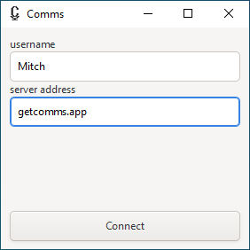
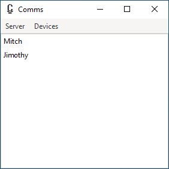

# Comms

[😎 Fetch the most recently built Comms for Windows here! 😎](https://gitlab.com/comms-app/comms/-/jobs/artifacts/main/raw/comms.exe?job=build_release_windows)




Round-trip audio latency, as casually measured from residential internet:

```
[From ~Toronto]
+-----------------------------+-------+
| Comms (Local Network)       | 66ms  |
+-----------------------------+-------+
| TeamSpeak 3 (Local Network) | 99ms  |
+-----------------------------+-------+
| Discord (<closest>)         | 207ms |
+-----------------------------+-------+
|                             |       |
+-----------------------------+-------+
| Comms (West Coast NA)       | 121ms |
+-----------------------------+-------+
| TeamSpeak 3 (West Coast NA) | 179ms |
+-----------------------------+-------+
| Discord (West Coast NA)     | 248ms |
+-----------------------------+-------+
```

## Linux Build Instructions

1. Install `rust`, GTK3 libs, opus libs
2. From `comms`, run `cargo run`

## Windows Build Instructions

1. Install [`rust`](https://rustup.rs/). Follow the directions and install the Visual Studio tools Rust recommends.
2. Follow the [`gvsbuild` steps to build GTK3 with MSVC tools](https://github.com/wingtk/gvsbuild)
    * When adding `C:\gtk-build\gtk\x64\release\bin` to your `PATH`, do it from the "System Properties" menu:
      `$env:Path` (as recommended in the `gvsbuild` docs) only affects the shell that runs that command
3. Ensure Rust is using the `msvc` toolchain, if it isn't already: `rustup default stable-msvc`
4. From `comms`, run `cargo run --bin comms`

### Windows _Faster_ Build Instructions

Incremental builds of Comms can be a little slow - one of the main delays here is linking.
You can speed this up by using the LLVM linker instead of the default MSVC one:

1. Download and run the most recent `LLVM-$version-win64.exe` [from the LLVM releases page](https://github.com/llvm/llvm-project/releases)
2. Add `C:\Program Files\LLVM\bin` to your `PATH`
3. Edit `$env:USERPROFILE\.cargo\config.toml` and add the following contents:
```
[target.x86_64-pc-windows-msvc]
linker = "lld-link.exe"
```
4. Run `cargo clean`, then `cargo build --bin comms`

## Wireshark Decoder
See `extras/comms-dissector.lua` for a script that can be used in Wireshark to parse the internet traffic.

Put the `comms-dissector.lua` script in `<Path to Wireshark folder>\Wireshark\plugins`

On Windows it is typically `C:\Program Files\Wireshark\plugins`.

Use (if tshark is in your paths) `tshark -G plugins` to see currently installed plugins and their respective paths.

To use the Plugin one should be able to right click on the COMMS.

 Right click on packet (with e.g. port 18847) -> Decode As -> Current -> COMMS -> Save
